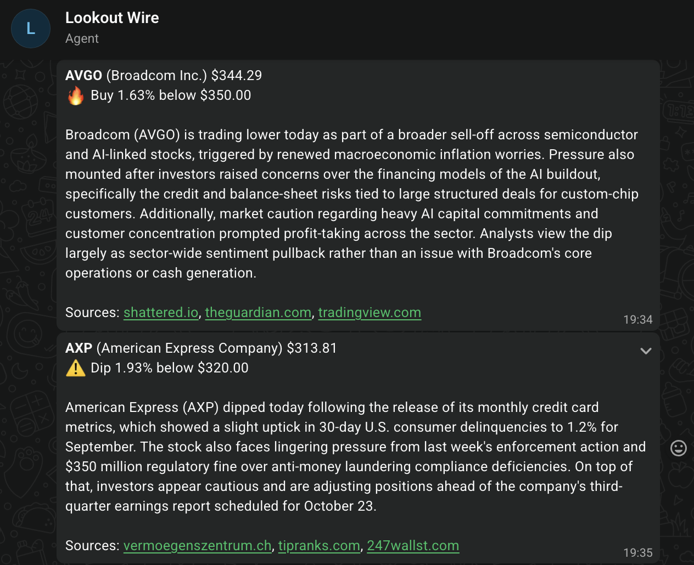

# Lookout Wire

A personal WhatsApp agent for financial alerts. One process runs on your laptop, checks the
watchlist every 2 minutes during US market hours, and messages you in WhatsApp when a stock
trades below a price you chose. With a Gemini key it adds a short explanation of why the stock
is down, naming its sources.



## Setup

Needs [uv](https://docs.astral.sh/uv/) and [just](https://github.com/casey/just) (`brew install just`).

```bash
just install
cp .env.example .env                       # fill in your keys; the Gemini key is optional
cp watchlist.example.yaml watchlist.yaml   # edit your tickers
just check-watchlist
just run
```

On first start the app asks you to send any message to your agent in WhatsApp. It learns your
id from that message, replies with a greeting, and starts watching prices. It remembers the
pairing, so later starts skip this step. Stop it with Ctrl-C.

Each external service needs a one-time setup first; see the next section.

## External services

The agent uses three services. WhatsApp and Alpaca are required; Gemini is optional. Every key
goes in `.env`, which is gitignored.

### WhatsApp: where alerts arrive

The agent uses WhatsApp's third-party agents feature, which is still rolling out in 2026.

1. In WhatsApp, open **Settings > Agents > Create an agent**, and give it a name and a photo.
2. Open the agent's chat, then **Chat info > API key**, and copy the key.
3. Put it in `.env` as `LOOKOUT_WHATSAPP_TOKEN`.
4. Run `just run` and send the agent any message when the log asks. The agent learns your id from
   that message and replies with a greeting.

Quirks:

- **Only you can chat with your agent.** It cannot message anyone else, and you can have up to five
  agents.
- **Agent chats are not end-to-end encrypted.** A Meta service handles them, so Meta can see
  your alerts and the levels in them.
- **Regenerating the key, or reinstalling WhatsApp, invalidates the old key.** The agent then
  stops with an error naming `LOOKOUT_WHATSAPP_TOKEN`. Paste the new key into `.env` and restart.
- **Pairing ignores messages sent before the agent started.** If it waits for pairing, send a new
  message.
- **Your id can change** if you change phone number. The agent notices the rejection and asks to
  pair again.
- **WhatsApp allows about 12 messages a minute per agent.** The agent spaces sends 10 seconds
  apart, half that limit.
- **Unverified:** whether WhatsApp delivers a message when you haven't written to the agent for
  over 24 hours. Live check 2 below tests this.
- `just whatsapp-id` and `just whatsapp-send` check the setup. Pass message text as a plain second
  argument: `just whatsapp-send user:123 "hello"`, not `message="hello"`, which would be sent
  literally.

### Alpaca: where prices come from

1. Create a free account at [alpaca.markets](https://alpaca.markets).
2. In the dashboard, switch to your **paper trading** account and generate an API key and secret.
3. Put them in `.env` as `LOOKOUT_ALPACA_KEY_ID` and `LOOKOUT_ALPACA_SECRET_KEY`.
4. Run `just check-alpaca`; both lines should say OK.

Quirks:

- **Use paper keys.** They serve market data just as well as live keys, and a leaked paper key
  cannot trade real money. Paper keys were confirmed to work for prices on 2026-10-15.
- **Live keys need a different trading host.** Set
  `LOOKOUT_ALPACA_TRADING_URL=https://api.alpaca.markets` in `.env`, or the market-clock check
  fails.
- **The free plan only has IEX prices.** IEX is one exchange, so a thinly traded stock's latest
  trade can be minutes old. The agent counts only trades inside today's regular session.
- **The latest trade outside market hours is an after-hours price.** The running agent ignores
  it; `just scan` uses it.
- **The free plan allows 200 requests a minute.** The agent uses about one: a price request and a
  clock request every 2 minutes.

### Gemini: why a stock is down (optional)

1. Go to [aistudio.google.com](https://aistudio.google.com), click **Get API key**, then **Create
   API key**.
2. **Set up billing on the project.** Google's free tier does not include Google Search
   grounding, which the explanations need.
3. Set a **project spend cap** in AI Studio, for example $5 a month.
4. Put the key in `.env` as `LOOKOUT_GEMINI_API_KEY`.
5. Run `just scan`. If no "Gemini explanation failed" warning appears, explanations work.

Quirks:

- **The free tier does not work, even though the model looks free.** Every request fails with
  `HTTP 429 RESOURCE_EXHAUSTED: You exceeded your current quota` from the very first one, because
  the free tier gives zero quota for search grounding. The rate-limit page shows the model with
  free quota, which is misleading. Attaching billing fixes it.
- **Cost:** search grounding costs about $14 per 1,000 searches, roughly 1.4 cents per alert. The
  model's own cost for a short answer is a small fraction of that, so a cheaper "Lite" model saves
  almost nothing.
- **Free-tier requests may be used to improve Google's products.** They include your tickers and
  levels. Paid-tier requests are not used that way.
- **The spend cap is enforced with about a 10-minute delay.** Usage in that window is still billed.
- **Model names change.** The default is `gemini-3.8-flash`. Google retired two Flash models in
  2026, so if requests fail with `HTTP 404 NOT_FOUND`, list the models your key can use and set
  `LOOKOUT_GEMINI_MODEL`:

  ```bash
  uv run python -c "
  from google import genai
  from lookout_wire.core.settings import load_settings
  client = genai.Client(api_key=load_settings().gemini_api_key.get_secret_value())
  print([m.name for m in client.models.list() if 'flash' in m.name])
  "
  ```

- **A slow answer fails with `HTTP 504 DEADLINE_EXCEEDED`, not a client timeout.** The SDK
  passes the timeout to Google, and Google stops the search-grounded answer when it runs out. The
  default is 30 seconds; set `LOOKOUT_EXPLAIN_TIMEOUT_SECONDS` to change it. An alert waits up to
  that long for its explanation.
- **When Gemini fails, the alert still arrives,** just without the explanation, and the log says
  why.
- **Sources are names, not links.** Gemini's links are long Google redirect URLs, and WhatsApp
  cannot attach a link to a name, so alerts end with a line like `Sources: reuters.com, cnbc.com`.
  WhatsApp makes each name tappable on its own; it opens the site's home page, not the article.

## Commands

Run `just` to list every recipe.

| Command | What it does |
|---|---|
| `just install` | Install dependencies into `.venv` and switch on the pre-commit hook |
| `just run` | Start the agent |
| `just scan` | Message every ticker below its Dip or Buy level right now, market open or not, then exit |
| `just check-watchlist` | Check `watchlist.yaml` is well formed: valid numbers, Buy below Dip, no symbol twice. Needs no keys |
| `just check` | Lint, format check, and tests: run before every commit |
| `just test` | Run the tests; extra arguments go to pytest, e.g. `just test -k rules` |
| `just coverage` | Test coverage per file, listing lines no test runs. `just coverage html` also writes `htmlcov/index.html` |
| `just fix` | Fix what ruff can fix, then format |
| `just lint` / `just format` | Lint only / format only |
| `just check-alpaca` | Live check 1, below |
| `just whatsapp-id` / `just whatsapp-send ID [TEXT]` | Live check 2, below |

Tests never touch the network. The live-check recipes read your keys from `.env`; nothing else
in the justfile does.

A pre-commit hook in `.githooks/` runs `just check` before every commit and stops the commit if
anything fails. `just install` switches it on. To skip it once in an emergency, use
`git commit --no-verify`.

Changes reach `main` through pull requests. GitHub Actions runs the same `just check` on every
pull request (`.github/workflows/ci.yml`), and `main` only accepts a merge once it passes.

## Watchlist

`watchlist.yaml` lists the tickers to watch. It is gitignored, so your levels stay on your laptop.

```yaml
tickers:
  - symbol: AVGO
    name: "Broadcom Inc."   # optional, shown in messages with the ticker
    dip: 370                # first alert when the price trades below this
    buy: 350                # optional, must be below dip
```

The agent re-reads the file every cycle, so edits apply within 2 minutes without a restart.
Changing a level resets it. A file that fails to parse is ignored until you fix it, and the agent
keeps using the last good version. Run `just check-watchlist` after editing.

## Messages

Each alert names the ticker (bold in WhatsApp) and the company, the price, and the deepest level
crossed:

```
*AVGO* (Broadcom Inc.) $344.29
🔥 Buy 1.63% below $350.00
```

- ⚠️ marks the Dip level and 🔥 the Buy level. When both fire, only Buy is shown.
- A later, deeper fall adds ", new low" to the line.
- With a Gemini key, a short explanation follows, then up to three source names:
  `Sources: reuters.com, cnbc.com`.

A complete alert as sent on 2026-10-15, with a Gemini key:

```
*AVGO* (Broadcom Inc.) $344.29
🔥 Buy 1.63% below $350.00

Broadcom (AVGO) is trading lower today as part of a broader sell-off across semiconductor and AI-linked stocks, triggered by renewed macroeconomic inflation worries. Pressure also mounted after investors raised concerns over the financing models of the AI buildout, specifically the credit and balance-sheet risks tied to large structured deals for custom-chip customers. Additionally, market caution regarding heavy AI capital commitments and customer concentration prompted profit-taking across the sector. Analysts view the dip largely as sector-wide sentiment pullback rather than an issue with Broadcom's core operations or cash generation.

Sources: shattered.io, theguardian.com, tradingview.com
```

## Alert rules

- A level alerts the first time the price trades below it.
- After that it alerts again only when the price trades below the lowest price you were already
  told about, at most once per level per trading day.
- When the price recovers to the level, the level re-arms silently.
- Changing a level in `watchlist.yaml` resets it.
- Prices count only during the regular US session (9:30 to 16:00 New York time), from trades
  inside it. Outside the session the agent checks nothing, so a quiet log then is normal.
- If market data fails for six cycles in a row (about 12 minutes), you get one message saying
  alerts are paused, and another when it recovers.
- The loop runs every 2 minutes by default. Set `LOOKOUT_INTERVAL_SECONDS` in `.env` to change it.

## Scan now

`just scan` reads the watchlist, fetches the latest trade for every ticker whether the market is
open or not, and sends one message per ticker below its Dip or Buy level, then prints a summary:

```
Sent (2): NVDA, MSFT
Above their levels, nothing sent (43): AAPL, ...
```

The summary also lists any ticker Alpaca returned no price for, and any message that could not be
sent; in that case the command exits non-zero.

It ignores alerts already sent and never changes the agent's saved alert state, so the agent's
own alerts still fire normally. Outside market hours the latest trade can be an after-hours
price. Sends are spaced 10 seconds apart to respect WhatsApp's limit, so many tickers take a few
minutes.

## Live checks

These need your real keys and cannot run in tests.

### 1. Alpaca keys serve prices and the market clock

```bash
just check-alpaca
```

It reports OK or NOT OK for prices (AAPL's last trade from the data host) and for the market
clock (from the trading host), with details under each, and exits non-zero if either fails. If
only the clock fails and you use live keys, set
`LOOKOUT_ALPACA_TRADING_URL=https://api.alpaca.markets` in `.env`.

Result: OK on 2026-10-15. Both the snapshot and the clock returned data.

### 2. WhatsApp delivers a message you did not reply to within a day

Send any message to your agent in WhatsApp, then run:

```bash
just whatsapp-id
```

It prints your id (it looks like `user:123...`), when you last messaged the agent, and whether the
24-hour check can run yet. Once it says ready, without messaging the agent again, send:

```bash
just whatsapp-send user:YOUR_ID
just whatsapp-send user:YOUR_ID "any text you like"
```

The message must arrive. If it is rejected, push alerts cannot work and the design needs a
rethink.

Result: not run yet. Sends inside the reply window worked on 2026-10-15; the 24-hour case is
still open.

### 3. Pairing, explanation, and a real alert

During US market hours, put a ticker in `watchlist.yaml` with a `dip` above its current price,
then run:

```bash
just run
```

1. Send any message to your agent when the log asks; a greeting comes back.
2. Within about 3 minutes you get one alert with the price, the level, and, with a Gemini key,
   a short explanation and its sources.
3. Later cycles send nothing more for that level today.

Result: pairing OK on 2026-10-15, greeting received. Explanations OK the same day through
`just scan` with `gemini-3.8-flash`; its links were Google redirect URLs, so alerts show source
names instead. A real alert during market hours is still to come.

## How it works

- `src/lookout_wire/main.py` loads settings, pairs with WhatsApp, and runs the loop, or a one-shot
  scan with `lookout-wire scan`.
- `src/lookout_wire/core/` holds the loop, settings, port interfaces, and the state-file helper.
- `src/lookout_wire/adapters/` has one module per external system: Alpaca, WhatsApp, Gemini.
- `src/lookout_wire/capabilities/watchlist/` is the first capability: config, level rules,
  alert state, message text, the scan, and the capability that ties them together.
- `src/lookout_wire/checks.py` runs the live and watchlist checks behind the `just check-*` and
  `just whatsapp-*` recipes.
- Alert state and the WhatsApp pairing live in `state/`, which is gitignored.

To add a capability, create a package under `capabilities/`, give it a factory taking settings
and ports, register it in `CAPABILITIES` in `main.py`, and enable it with
`LOOKOUT_ENABLED_CAPABILITIES='["watchlist", "your_name"]'`. The loop calls its `run(now)` every
tick; the capability decides for itself whether there is work to do.
