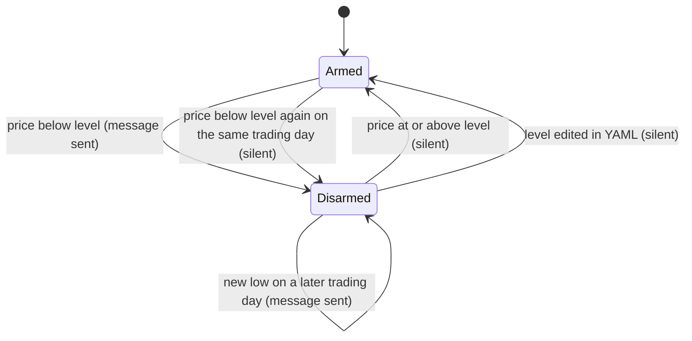
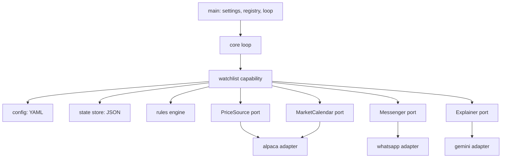
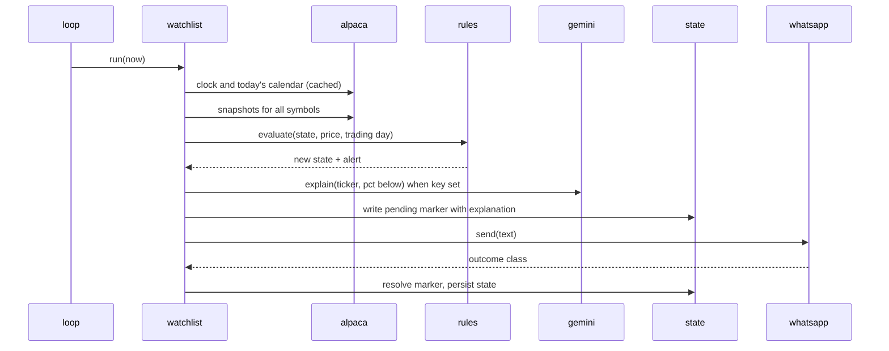

# WhatsApp Watchlist Dip Alerts - Plan

## Goal Capsule

- **Objective:** The owner learns within about a minute, in WhatsApp, when a watched US stock drops below a price they chose, with a cited explanation of why, and never gets the same alert twice.
- **Means:** One always-on Python process on the owner's laptop that polls Alpaca prices against a YAML watchlist and sends through the WhatsApp Agent Platform (KTD1, KTD4, KTD5, KTD8). The watchlist is the first capability in a repository laid out to take more (KTD2).
- **Product authority:** The Product Contract below. The owner is the only user. Later capabilities of the same agent are context only, not active scope.
- **Execution profile:** Greenfield Python 3.14 project managed with uv. Eight implementation units in dependency order, each landing as one commit. Unit tests run with no network. One manual run during market hours closes the work.
- **Stop conditions:** Stop and ask the owner if the Alpaca keys do not serve the free price feed or the configured trading host (U1), if a WhatsApp send made more than a day after the owner's last message is rejected (U1), if the WhatsApp agent API rejects the owner's token at pairing (U6), or if evidence shows a settled product decision cannot work.
- **Who finishes:** The implementing agent lands the units; the owner runs the market-hours check and keeps the process running. Git initialization is part of U1 because the directory is not a repository yet.

---

## Product Contract

### Summary

A personal WhatsApp agent whose first capability is price-level alerts. The process re-reads a hand-edited YAML watchlist every cycle, fetches each ticker's latest Alpaca price during the US regular session, and sends one WhatsApp message the first time a price crosses below a Dip level or an optional lower Buy level, repeating at most daily and only on a new low. When an LLM API key is configured, the message carries a short search-grounded explanation of the move with the names of its sources. The repository is structured so each future capability is its own package with its own tests, run by the same single main script.

### Problem Frame

The owner follows a handful of tickers and wants to buy on dips. Today a dip is noticed only when they happen to look at Google Finance or the broker app, and learning why the stock fell is a second manual trip. Existing alert products either charge for the feature or deliver by email, and email goes unread. None of them explain the move. Google Finance's "key moments" shows the kind of explanation wanted, but it has no alerting and no API.

### Key Decisions

- **Alert once per crossing, then daily only on a new low, with at most one message per level per trading day.** Avoids daily repeats while a stock sits under a level for weeks, still surfaces when the fall deepens, and bounds a price that hovers at the level. Governs R8, R9, R10. (session-settled: user-directed — chosen over one message per level per day and over once-per-crossing with no repeats: daily repeats are noise, but a deeper fall is news.)
- **The new-low baseline is the lowest price the owner was already notified about.** Prices seen silently under the daily cap do not raise the bar. Governs R8, R9. (session-settled: user-directed — chosen over the lowest price observed while disarmed: the owner wants a message whenever the stock trades below any price they were told about.)
- **Push only. The owner edits the YAML by hand.** Governs R1, R26. (session-settled: user-directed — chosen over reply commands and free-text questions in chat: keeps the first build to the loop and the sender.)
- **Explanation from a search-grounded LLM, one call per alert.** Governs R14, R15, R16. (session-settled: user-directed — chosen over summarizing the Alpaca news feed and over a two-path hybrid: explanation quality is the main value, and the volume is a few calls a day.)
- **Gemini is the first LLM provider, behind an interface.** Its search uses the Google index and its free search quota covers the expected volume. Governs R17. (session-settled: user-approved — proposed over Anthropic and OpenAI as the first provider with cost and index as the tradeoff; the owner accepted.)
- **The explanation is on when an LLM key is present and off when it is not.** Governs R13.
- **Prices are checked only during the US regular session, and "day" means the New York trading day.** Keeps the state machine and tests simple. Governs R5, R10.
- **One main script, one process, capabilities as packages.** Set by the owner as the shape every later capability joins. Governs R21, R22, R23.
- **The loop runs every 120 seconds by default.** Set by the owner, who changed it from 10 seconds on 2026-10-15. An alert can arrive up to about two minutes after a crossing. Governs R4.

### Actors

- A1. Owner: the only human. Edits the watchlist, pairs the agent once, receives messages.
- A2. Watchlist capability: the code that evaluates levels and composes alerts inside the main loop.
- A3. Alpaca Market Data: price source and market clock.
- A4. WhatsApp Agent Platform: message transport, addressed by the owner's agent API key.
- A5. LLM provider with web search: explanation source. Optional at runtime.

### Requirements

**Watchlist and levels**

- R1. The watchlist is a YAML file the owner edits by hand, listing tickers with a required Dip price and an optional Buy price.
- R2. A ticker whose Buy price is not below its Dip price is reported as a configuration error and skipped, without stopping other tickers.
- R3. The watchlist is re-read every cycle, so an edit takes effect without a restart. When the file fails to parse, the cycle logs the error and evaluates the last successfully parsed watchlist, and state is reset or dropped per R26 only from a successfully parsed file.

**Price checking**

- R4. The main loop runs every 120 seconds by default, with the interval configurable.
- R5. Levels are evaluated only while the US market is in its regular session, as reported by the market clock from A3.
- R6. The price compared to a level is the latest trade from A3 for that ticker whose timestamp falls inside the current regular session. A ticker with no such trade yet is skipped for that cycle and logged as in R7.
- R7. A ticker whose price cannot be fetched is skipped for that cycle and logged, without affecting other tickers.
- R28. When every ticker's price fetch, or the market clock, fails for 6 consecutive cycles during the session, the agent sends one message saying so, and one more when a fetch succeeds again.

**Alert rules**

- R8. A level fires when the price is below it, the level is armed, and no message has been sent for that level on the current trading day. Firing sends one message and disarms the level. A re-armed level that would fire again on the same trading day is disarmed silently and leaves the new-low baseline of R9 unchanged.
- R9. A disarmed level sends again only when the price is below the lowest price already alerted for that level, at most once per trading day, and never on the trading day of the previous message for that level.
- R10. A disarmed level re-arms when the price is at or above the level.
- R11. When the Dip and Buy levels of one ticker fire in the same cycle, one message covers both and shows only the Buy level.
- R12. The Buy level is independent of the Dip level's state: Buy can fire while Dip is disarmed.

**Message content and explanation**

- R13. Every alert message names the ticker in bold, the company name when the watchlist gives one, the latest price, and the deepest level that fired with its value and the percentage the price sits below it. An explanation per R14 is appended only when an LLM key is configured.
- R14. The explanation is a short summary of why the stock is down today, produced by one call to A5 with web search, followed by the names of up to three sources. Links are not sent: WhatsApp cannot attach a link to a name, and Gemini's links are long Google redirect URLs. It is fetched at most once per alert and kept with the alert, so a retried send never repeats the call.
- R15. When the explanation call fails or times out, the alert is still sent without it, and the failure is logged.
- R16. A message stays within the transport's text limit of 4096 characters; the explanation is truncated first.
- R17. The LLM provider sits behind an interface, with Gemini as the first implementation.

**WhatsApp delivery and pairing**

- R18. Messages are sent through the WhatsApp Agent Platform using the owner's agent API key.
- R19. The recipient id is learned from a message the owner sends the agent, stored, and reused for every later send.
- R20. Sends respect the transport's limit of 12 messages per minute per agent, and each send outcome is handled by its class:
  - **Rate limited or not accepted (429, or 503 with code 131016):** back off with a delay that grows across cycles, and keep the level armed so a later cycle retries.
  - **Invalid token (401, or 400 with code 100):** stop the process with a clear error and do not retry until the key is replaced.
  - **Rejected recipient (403):** clear the stored recipient id so pairing per F1 runs again, log the alert as undeliverable, and record the level as if sent.
  - **Any other 4xx:** do not retry, log the alert as undeliverable, and record the level as if sent.
  - **Unknown outcome (other 5xx, connection reset, read timeout):** treat the message as sent, record the level accordingly, and log the uncertainty.

**Repository structure and code quality**

- R21. One main script starts the process and runs the loop. It is the only entry point.
- R22. Each capability is its own package with its own tests, and the loop runs every enabled capability each cycle. Adding a capability means adding a package and enabling it, with no change to the main script's logic.
- R23. The price source, the messenger, and the LLM provider are each behind an interface with one implementation, so any can be replaced without touching the capability.
- R24. The code is Python managed with uv, with unit tests that run without network access. Methods are short, use early returns, and are easy to read.

**State, configuration, and secrets**

- R25. Alert state per ticker and level persists on disk, so a restart does not re-send an alert already sent.
- R26. Changing a ticker's level in the YAML resets that level's state to armed. Removing a ticker drops its state.
- R27. API keys and the recipient id are read from environment variables or a local untracked file, never from the watchlist YAML or the repository.



The diagram shows one level's state; a ticker holds one such state per configured level. The rules live on R8 through R10 and R26.

### Key Flows

- F1. First-run pairing
  - **Trigger:** The process starts with no stored recipient id.
  - **Actors:** A1, A2, A4
  - **Steps:** The process tells the owner to send any message to the agent in WhatsApp. It reads the owner's id from that inbound message, stores it, and confirms by sending a greeting. Polling for inbound messages stops once the id is stored.
  - **Covered by:** R19, R27

- F2. A crossing during the session
  - **Trigger:** A cycle runs while the market is open and a ticker's price is below an armed level.
  - **Actors:** A1, A2, A3, A4, A5
  - **Steps:** The capability composes the alert, asks A5 for an explanation when a key is configured, sends through A4, records the alerted price and trading day, and disarms the level.
  - **Covered by:** R5, R6, R8, R13, R14, R18, R25

- F3. A deeper fall on a later day
  - **Trigger:** A disarmed level sees a price below its lowest alerted price on a later trading day.
  - **Actors:** A1, A2, A3, A4, A5
  - **Steps:** Same as F2, but the message notes it is a new low and the level stays disarmed.
  - **Covered by:** R9, R13

- F4. Recovery and re-arm
  - **Trigger:** A disarmed level sees a price at or above the level.
  - **Actors:** A2, A3
  - **Steps:** The level re-arms silently. A later drop below the level fires again as in F2.
  - **Covered by:** R10

- F5. Level edit
  - **Trigger:** The owner changes a ticker's Dip or Buy value in the YAML.
  - **Actors:** A1, A2
  - **Steps:** The next cycle reads the new value, resets that level's state to armed, and evaluates it.
  - **Covered by:** R3, R26

### Acceptance Examples

- AE1. **Covers R8, R13.** Given AAPL has Dip 150 armed and no LLM key is set, when the latest price is 149.80 during the session, then one message arrives naming AAPL, 149.80, Dip 150, and 0.13% below, with no explanation, and Dip is disarmed.
- AE2. **Covers R11, R12.** Given NVDA has Dip 150 and Buy 130 both armed, when the price is 128, then one message shows the Buy level, and both levels are disarmed.
- AE3. **Covers R9.** Given AAPL Dip fired today at 149.80, when the price falls to 147 later the same trading day, then no message is sent.
- AE4. **Covers R9.** Given AAPL Dip fired yesterday at 149.80, when today's price is 147, then one new-low message is sent, and a further fall to 145 today sends nothing.
- AE5. **Covers R9.** Given AAPL Dip fired yesterday at 149.80, when today's price is 149.90 and still below 150, then no message is sent.
- AE6. **Covers R10, R8.** Given AAPL Dip is disarmed by a message sent on an earlier trading day, when today's price reads 150.00 and on a later cycle 149.50, then Dip re-arms at 150.00 silently and fires once at 149.50.
- AE19. **Covers R8, R10.** Given AAPL Dip 150 fired today at 149.90, when the price reads 150.05 and then 149.85 on the same trading day, then no second message is sent, Dip is disarmed, and the baseline stays at 149.90, so a price of 149.87 on a later trading day sends a new-low message.
- AE7. **Covers R25.** Given AAPL Dip fired an hour ago, when the process restarts and the price is still 149, then no message is sent.
- AE8. **Covers R26.** Given AAPL Dip 150 is disarmed, when the owner edits Dip to 145 and the price is 149, then no message is sent and Dip is armed; a later price of 144 fires.
- AE9. **Covers R15.** Given an LLM key is set and the provider times out, when a level fires, then the alert arrives without an explanation and the failure is logged.
- AE10. **Covers R5.** Given AAPL is below its Dip level, when the market is closed, then no message is sent and no explanation call is made.
- AE11. **Covers R20.** Given the transport returns a rate-limit response, when a level fires, then the send is retried after a growing backoff, and if it still fails the level stays armed and the failure is logged.
- AE14. **Covers R20.** Given the transport times out after the request is sent, when the next cycle runs with the price still below the level, then no second message is sent and the uncertainty is logged.
- AE15. **Covers R14, R19, R20.** Given the stored recipient id is stale and the transport rejects the recipient, when a level fires, then no second explanation call is made, the stored id is cleared, pairing runs again, and the level is recorded as sent.
- AE16. **Covers R20.** Given the agent API key was regenerated in WhatsApp, when a level fires, then the process stops with a clear error naming the token and sends nothing further.
- AE17. **Covers R6.** Given AAPL's latest trade on the feed is a pre-market print below its Dip level, when the session has opened and no regular-session trade has printed yet, then no message is sent and the ticker is logged as skipped.
- AE12. **Covers R2, R7.** Given one ticker has Buy above Dip and another ticker's price fetch fails, when a cycle runs, then both are logged and every other ticker is evaluated.
- AE18. **Covers R3, R25.** Given AAPL Dip is disarmed, when the YAML is unparseable for one cycle and valid again on the next with AAPL unchanged, then no message is sent and Dip stays disarmed.
- AE20. **Covers R28.** Given the Alpaca key is wrong, when 6 consecutive cycles fail during the session, then one message reports the failure, no further failure messages follow, and one message reports recovery once a fetch succeeds.
- AE13. **Covers R19.** Given no recipient id is stored, when the process starts, then it waits for an inbound message, stores the sender id, and sends a greeting to it.

### Success Criteria

- A crossing produces a WhatsApp message within one loop interval plus one minute (about three minutes at the default), including the explanation call.
- No level ever produces two messages for the same crossing or the same new-low day, across restarts.
- The unit test suite runs with no network access and exercises every Acceptance Example above against fake price, messenger, and LLM implementations.
- A second capability can be added by creating a package and enabling it, without editing the main script's logic.

### Scope Boundaries

Deferred for later:

- Replying to the agent in WhatsApp: adding tickers, asking follow-up questions.
- Upper price levels, percentage-from-reference levels, and trailing levels.
- Hysteresis around a level to suppress flapping when the price oscillates at the level.
- Extended-hours and pre-market evaluation.
- Crypto and non-US tickers.
- The Alpaca news feed as an explanation source, and Anthropic or OpenAI as providers.
- Running anywhere other than the owner's laptop.
- Other capabilities of the agent, such as daily digests or portfolio summaries.

Considered during planning and not built:

- A thread pool to fetch several explanations in parallel when many tickers cross in one cycle. A few alerts a day do not need it; build it if a sell-off shows alerts arriving minutes apart.
- Debouncing watchlist edits across two consecutive parses to absorb editor autosave intermediates. A retyped value that passes through a valid intermediate within one cycle could re-arm a level and send one duplicate; the owner sees it at once. Build it if that happens in practice.
- A backup copy of the state file for recovery from a corrupt file after a power loss. With fsync before the rename this is rare, and a re-fire after deleting the file is visible immediately. Build it the first time the file is found corrupt.

### Dependencies / Assumptions

- The owner's WhatsApp account has the third-party agents feature and an agent created, and the API key is the one shown under the agent's chat info.
- The WhatsApp Agent Platform lets an agent message its creator without the creator having written within any time window; the developer manual states no such window.
- The Alpaca account is on the free plan, so prices come from the IEX feed. Whether paper-trading keys authenticate market data is unconfirmed; U1 verifies it with one request before anything else is built.
- A Gemini API key with web search enabled is available when the owner wants explanations.
- The laptop is awake and online during the session; alerts stop when it sleeps. A crash or a sleeping laptop cannot announce itself, and that gap is accepted; R28 covers only failures the running process can see.
- The owner's WhatsApp recipient id can change after a phone number change or re-registration, in which case pairing per F1 runs again.
- Regenerating the agent API key in WhatsApp, or reinstalling the app, invalidates the stored token and requires updating the local secret.

### Open Questions

Deferred to implementation:

- The exact explanation prompt wording. It names the ticker, the percentage below the level, and today's date; U7 settles the rest against real responses.

### Sources / Research

- WhatsApp Agent Platform Developer Manual, version 1, 2026-08-25: https://www.whatsapp.com/developer/WhatsApp-Agent-Platform-Developer-Manual.pdf. Base URL, bearer auth, `POST /agent/v1/messages`, `GET /agent/v1/updates` long-poll, 12 sends and 15 polls per minute, 4096-character text limit, identifier stability notes.
- WhatsApp third-party agents FAQ: https://faq.whatsapp.com/cxt/?entrypointid=3p-agent-learn-more. Five agents per account, creator-only chat, not end-to-end encrypted.
- Alpaca market data plans: https://docs.alpaca.markets/docs/about-market-data-api. Free plan is IEX feed, 200 calls per minute.
- Alpaca multi-symbol snapshots: https://docs.alpaca.markets/reference/stocksnapshots-1. One call returns latest trade and quote for many symbols.
- Gemini grounding with Google Search: https://ai.google.dev/gemini-api/docs/google-search. 14 dollars per thousand searches after 5,000 free per month, citations returned.
- Anthropic web search tool: https://platform.claude.com/docs/en/agents-and-tools/tool-use/web-search-tool. 10 dollars per thousand searches, citations always on. Candidate second provider.
- OpenAI Responses web search: https://developers.openai.com/api/docs/guides/tools-web-search. 10 dollars per thousand calls. Candidate second provider.
- Google Finance "key moments" announcement, 2026-06-25: https://blog.google/products-and-platforms/products/search/google-finance-updates-june-2026/. The explanation shape this plan imitates.

---

## Planning Contract

**Product Contract preservation:** changed: R11, R13, R14, AE2 — the owner chose the deepest-level message format, bold ticker with company name, and source names instead of links; R4 and its success criterion — the owner raised the default loop interval from 10 to 120 seconds; R8, AE19 — the new-low baseline is the lowest price already notified, per the owner's decision recorded in Key Decisions; Outstanding Questions resolved in place and renamed Open Questions; Scope Boundaries gained a considered-and-not-built list from planning. All other requirements, flows, and examples are unchanged.

### Key Technical Decisions

- KTD1. **One distribution with a src layout and subpackages per concern.** `src/lookout_wire/core` holds the loop, settings, ports, the registry type, and the shared state-file helper; `src/lookout_wire/adapters` holds one module per external system; `src/lookout_wire/capabilities/<name>` holds each capability with its own tests under `tests/capabilities/<name>`. The name-to-factory mapping of capabilities lives in `main.py`, never in core, so core imports no capability. uv manages the project with the `uv_build` backend, a `[project.scripts]` entry point, and a `dev` dependency group for pytest and ruff. Subpackages under one top-level package avoid multi-module build configuration. Governs R21, R22, R24.
- KTD2. **Capabilities implement one protocol, self-schedule from a tick, and are enabled by an explicit registry.** The loop is a tick source: once per cycle it takes `now` as a timezone-aware UTC datetime and calls `run(now)` on every enabled capability with the same value. A capability decides for itself what to do on a tick, so a future daily digest runs once after the close by remembering its last run day; no declared schedule is needed now and one can be added later as an optional attribute. A factory receives the settings and a `Ports` bundle (price source, market calendar, messenger, explainer, state directory, clock) and returns a capability. The registry type and its unknown-name error live in core; the mapping and the enabled-names setting default to the watchlist. An exception from a capability is logged and the cycle continues, except a `FatalError`, which sets the stop event and exits non-zero; the invalid-token outcome of R20 is fatal. Chosen over entry-point or import-time discovery: one owner, no plugins to load. Governs R21, R22.
- KTD3. **Ports as protocols, one adapter each, fakes for tests.** `PriceSource`, `MarketCalendar`, `Messenger`, and `Explainer` are typing protocols in the core package with small result types: a trade (price, timestamp), a session (is open, trading day, and open and close bounds that are absent on a day with no session), a send outcome, and an explanation (text, source names). A pure `in_session(trade, session)` helper sits in core beside those types so every price-reading capability applies R6 the same way. `Explainer.explain(question)` takes finished prompt text and knows nothing about tickers, so a later capability reuses the same adapter. Each port has one adapter; tests use in-memory fakes under `tests/fakes.py`. Governs R23, R24.
- KTD4. **A synchronous loop with a stop event, per-call timeouts, and no sleeping inside adapters.** Each cycle runs every enabled capability, then waits on a threading event for the interval, so a SIGINT or SIGTERM ends the wait at once; an in-flight call completes first, which can take up to the explanation timeout. Timeouts: 5 s for prices and clock, 20 s for the explanation, 5 s connect and 15 s read for a WhatsApp send, and a 30 s read timeout for the pairing long-poll so the server's own 25 s timeout, not the client's, ends an idle poll. Adapters never sleep for backoff or spacing; they return a not-before time and the next cycle retries, so one slow ticker cannot stall the loop. Alerts in one cycle are handled in sequence: the first alert of a cycle meets the success criterion in the worst case, and further alerts in the same cycle follow at one send per 10 s. An asyncio design would make fan-out natural but turns every port, fake, and test async and changes signal handling; with a few alerts a day it is not worth it, and a thread pool for parallel explanation calls was considered and not built for the same reason (see Scope Boundaries). Governs R4; serves the one-minute success criterion.
- KTD5. **Alpaca over HTTPS with httpx, not the alpaca-py SDK.** The SDK sets no request timeout on any call, so one stalled socket would freeze the loop. The adapter calls `GET /v2/stocks/snapshots` with `feed=iex` on the configured data host, and `GET /v2/clock` and `GET /v2/calendar` on the configured trading host, which defaults to the paper host because paper keys authenticate only there and live keys only on the live host. The calendar for today is fetched once per trading day and cached, keyed by the loop's `now`; the clock's own timestamp, not the laptop clock, sets the trading day as its calendar date in America/New_York. An empty calendar response, which is what a weekend or holiday returns, yields a closed session with no bounds, cached for that day like any other, and is not a clock failure. A trade counts only when its timestamp falls between that day's open and close (the core `in_session` helper of KTD3). Governs R5, R6, R7.
- KTD6. **A pure rules engine owns level state.** Level state is a frozen dataclass: kind (dip or buy), configured level, armed flag, baseline (lowest price already notified), day of last message, and an optional pending alert. Rules are functions from state plus a price and a trading day to new state plus zero or one alert. A `crossed` alert starts a new episode and sets the baseline to its price; a re-arm keeps the old baseline so a same-day re-fire under the cap compares against it (AE19); a `new_low` alert lowers the baseline to its price. No I/O and no clock inside, so every acceptance example is a table test. Governs R8, R9, R10, R11, R12, R26.
- KTD7. **State is one JSON file per capability, written atomically through a core helper, with a two-phase pre-send marker.** `core/state.py` writes a document to a fixed temp name in the state directory, fsyncs it (`F_FULLFSYNC` on macOS), and renames it over the target; the loader ignores and removes a leftover temp file and raises an error naming the path when the document cannot be parsed, so the process refuses to start rather than treating state as empty. The watchlist stores `state/watchlist.json` with each level's configured value so a YAML edit is detected (R26). A marker is per message: it carries every level in that message with kind, level value, price, the cycle's New York trading day, the explanation text and source names, and a phase. Phase `in_flight` is written before the POST; `not_sent` is persisted on a rate-limited, not-accepted, or invalid-token outcome before any retry or exit. On start, `in_flight` resolves as sent for every level in the marker (armed false, baseline the marker price, last message day the marker day) and `not_sent` resolves as armed with the explanation kept for the retry. A `not_sent` marker is discarded, explanation included, when a later cycle produces no alert for its ticker or its trading day differs from the cycle's, so a stale explanation is never reused for a new crossing. A marker write that fails aborts the send for that cycle. Governs R19, R25, R26, R27.
- KTD8. **WhatsApp adapter over httpx owns sending, pairing, and the recipient id.** The adapter maps HTTP results to the classes of R20 and returns them; it never sleeps. A connect error or connect timeout means the request never left the laptop, so it maps to the not-accepted class and the level stays armed; only failures after the request was sent (read timeout, connection reset, 5xx other than 503 with code 131016) are the unknown-outcome class. A 400 with code 100 whose `error.message` is a bare field name is the manual's length-cap rejection and maps to the other-4xx class; a 400 with code 100 and a sentence message, or a 401, is the invalid-token class and is raised as `FatalError` with the response message included. Spacing of at least 10 s between sends and a backoff that doubles from 10 s to a 60 s cap across consecutive rate-limited or not-accepted outcomes are both expressed as a not-before time the capability honors on later cycles. The adapter owns `state/whatsapp.json` (the recipient id, written through the core helper, gitignored) and `ensure_paired()`, which `main.py` calls at startup and the adapter calls itself after a rejected recipient; a capability only sees the rejected-recipient class. Pairing long-polls `GET /agent/v1/updates` starting at offset 0 with a 25 s timeout, ignores messages timestamped before the pairing started, carries `next_offset` after every 200, and re-polls with the same offset after a 204, so a message arriving between two polls is never missed. `ensure_paired()` receives the loop's stop event, checks it between polls, and returns without pairing when it is set so the process can still exit. A greeting rejected three times raises `FatalError`. Pairing blocks the loop while it runs. Governs R18, R19, R20.
- KTD9. **Gemini through google-genai 2.x generate_content with the Google Search tool.** The model id is a setting, default `gemini-3.8-flash`, because two Flash ids were retired in 2026. `gemini-3.5-flash-lite` was the first default but was not offered to the owner's account; search grounding is paid-only, and its per-search price dominates the cost, so the full Flash model costs little more than Lite. The request timeout is set in milliseconds through the client's HTTP options. The adapter takes finished prompt text (KTD3); the watchlist builds the prompt in its message module, naming the ticker, the percentage below the level, and today's date. Source names come from the response's grounding chunks, the title or else the domain, at most three. The first live call showed the chunk links are long Google redirect URLs, so no links are sent. The explanation is fetched once per pending alert and stored on the marker, so a retry or restart never repeats the call. The explainer is disabled when no key is set. Governs R13, R14, R15, R16, R17.
- KTD10. **Settings from the environment through pydantic-settings, secrets never logged.** All settings carry a `LOOKOUT_` prefix and load from the environment or a local `.env`. Secret fields are typed as secrets so their repr is masked, and the settings model hides input values in validation errors, because pydantic's missing-field error otherwise embeds every raw environment value, including the other secrets, in its message. Failure logs record HTTP status and error code, never headers or URLs with query strings, and the httpx and httpcore loggers run at WARNING so per-request URL lines are not emitted. Logging goes to stdout through the standard library. Governs R27.
- KTD11. **One message per ticker per cycle, showing the deepest level.** The first line is the ticker in WhatsApp bold, the company in parentheses, and the price, as `*AVGO* (Broadcom Inc.) $344.29`. The second line is `🔥 Buy 1.63% below $350.00` or `⚠️ Dip 1.93% below $320.00`, with `, new low` for a deeper fall. The explanation follows, then `Sources: reuters.com, cnbc.com`. Text beyond 4096 characters is cut from the explanation first. Governs R11, R13, R16.
- KTD12. **Watchlist YAML is a list of tickers with `symbol`, `dip`, and optional `buy`.** Symbols are upper-cased and stripped on parse. A ticker that fails R2 is skipped with its state untouched. The last successfully parsed watchlist is kept in memory for R3. Governs R1, R2, R3.
- KTD13. **The health notice of R28 is a counter in the watchlist capability.** Six consecutive cycles in which every fetch or the clock failed send one message; the first later success sends the recovery message and resets the counter. Governs R28.

### High-Level Technical Design

Components and the direction of calls:



One cycle during the session, for one ticker that crosses a level:



The level state machine lives in the Product Contract next to R8 through R10 and is not repeated here.

### Output Structure

```text
lookout-wire/
  pyproject.toml
  .python-version
  .gitignore
  .env.example
  README.md
  watchlist.example.yaml
  src/lookout_wire/
    __init__.py
    main.py
    core/
      __init__.py
      settings.py
      logging.py
      ports.py
      capability.py
      registry.py
      loop.py
      state.py
    adapters/
      __init__.py
      alpaca.py
      whatsapp.py
      gemini.py
    capabilities/
      __init__.py
      watchlist/
        __init__.py
        capability.py
        config.py
        state.py
        rules.py
        message.py
  tests/
    fakes.py
    core/
    adapters/
    capabilities/watchlist/
  state/            # runtime, gitignored
```

### Sequencing

U1 first. U2 depends on U1. U3 and U4 depend on U2 and can proceed in parallel. U5, U6, and U7 depend on U2 and are independent of each other. U8 depends on everything before it.

### Risks & Dependencies

- Paper-trading keys may not authenticate the market data host. U1 verifies with one request on each host; if they fail, the owner supplies live-account keys and sets the trading host setting to the live host.
- The WhatsApp Agent Platform may enforce a reply window the manual does not mention. U1 verifies a send made more than a day after the owner's last message before anything else is built; if it is rejected, the push-only product cannot work and the owner decides.
- The WhatsApp Agent Platform is in limited beta and its manual is version 1. A changed endpoint shape surfaces as 4xx responses in U6's live check, not in tests.
- httpx last shipped in December 2024 and lists no 3.14 classifier, but it imports and runs on 3.14.5. Pin a version in `pyproject.toml`.

---

## Implementation Units

### U1. Project scaffold, settings, and key verification

- **Goal:** A uv-managed project that installs, lints, tests, and loads settings, with the Alpaca key question answered.
- **Requirements:** R21, R24, R27.
- **Dependencies:** none.
- **Files:** `pyproject.toml`, `.python-version`, `.gitignore`, `.env.example`, `README.md`, `watchlist.example.yaml`, `src/lookout_wire/__init__.py`, `src/lookout_wire/core/__init__.py`, `src/lookout_wire/core/settings.py`, `src/lookout_wire/core/logging.py`, `tests/core/test_settings.py`.
- **Approach:**
  1. Initialize git and the uv project with a src layout (KTD1); add runtime dependencies httpx, pydantic, pydantic-settings, PyYAML, google-genai, and the dev group pytest and ruff; pin `requires-python` to 3.14.
  2. Define settings per KTD10: Alpaca key id and secret, Alpaca data host and trading host (defaults `https://data.alpaca.markets` and `https://paper-api.alpaca.markets`), WhatsApp token, optional Gemini key and model id, interval (default 120 s), watchlist path, state directory, enabled capabilities, and the timeouts of KTD4. Set the settings model to hide input values in validation errors (KTD10).
  3. Configure stdout logging with a format that never includes settings objects, and set the httpx and httpcore loggers to WARNING (KTD10).
  4. Make two authenticated requests with the owner's keys, one snapshot on the data host and one clock on the trading host, and record both results in the README.
  5. With curl, have the owner message the agent once, read the id from the updates endpoint, and at least 24 hours later with no further owner message post one text to that id; record in the README that the proactive send was delivered. This check may run while U2 through U7 are built, but it must pass before U8 starts.
- **Execution note:** This unit is packaging and configuration; prefer install and runtime smoke checks over broad unit coverage.
- **Patterns to follow:** uv project conventions from the Astral docs; pydantic-settings `SettingsConfigDict` with `env_prefix` and `env_file`.
- **Test scenarios:**
  - Settings load from environment variables with the `LOOKOUT_` prefix and from a `.env` file.
  - A missing Alpaca or WhatsApp secret raises an error naming the variable, and the error text contains none of the other configured secret values.
  - With logging configured, an httpx request through a mock transport writes no INFO line containing its URL.
  - With no Gemini key set, the explanation-enabled flag is false.
  - The repr of the settings object masks every secret value.
- **Verification:** `uv run pytest` and `uv run ruff check .` pass; `uv run lookout-wire --help` or an equivalent import succeeds; the README states whether the owner's keys served the IEX snapshot and the clock, and whether the proactive send was delivered.

### U2. Core loop, capability contract, ports, and fakes

- **Goal:** A loop that runs enabled capabilities every interval, stops cleanly on a signal, and exposes the four ports with test fakes.
- **Requirements:** R4, R21, R22, R23, R24.
- **Dependencies:** U1.
- **Files:** `src/lookout_wire/core/ports.py`, `src/lookout_wire/core/capability.py`, `src/lookout_wire/core/registry.py`, `src/lookout_wire/core/loop.py`, `src/lookout_wire/core/state.py`, `src/lookout_wire/main.py`, `tests/fakes.py`, `tests/core/test_loop.py`, `tests/core/test_registry.py`, `tests/core/test_state.py`.
- **Approach:**
  1. Define the port protocols of KTD3 with their result types, the `in_session` helper, and the `Ports` bundle.
  2. Define the capability protocol, the `FatalError` type, and the registry type of KTD2.
  3. Implement the loop of KTD4: take `now` once per cycle, run each enabled capability, log and continue on an ordinary exception, stop and exit non-zero on `FatalError`, wait on the stop event with signal handlers installed.
  4. Implement the atomic state-file helper of KTD7 in `core/state.py`: fixed temp name, fsync, rename, leftover cleanup, refuse on a corrupt document.
  5. `main.py` wires settings, logging, the capability mapping, and the loop; adapters are attached in U8.
- **Patterns to follow:** `typing.Protocol` for ports; `threading.Event.wait(timeout)` as the sleep.
- **Test scenarios:**
  - Two fake capabilities enabled: each runs once per cycle in registry order.
  - Setting the stop event during the wait ends the loop within one interval.
  - A capability that raises an ordinary exception is logged and the other capability still runs in the same cycle.
  - A capability that raises `FatalError` stops the loop and the process exits non-zero.
  - An unknown capability name in settings fails at startup with a clear error.
  - The interval setting controls the wait.
  - Every capability in a cycle receives the same `now`.
  - `in_session` accepts a trade inside the session bounds and rejects one before the open or after the close.
  - State helper: a document round-trips; a write interrupted before the rename leaves the previous file intact and the loader removes the leftover temp file; a corrupt document raises an error naming the path.
- **Verification:** The loop test suite passes with no sleeps longer than a second; `uv run lookout-wire` starts, logs one cycle with no capabilities enabled, and exits on Ctrl-C.

### U3. Watchlist config and state store

- **Goal:** Parse and validate the YAML watchlist, keep the last good copy, and persist level state atomically with the pre-send marker.
- **Requirements:** R1, R2, R3, R25, R26, R27.
- **Dependencies:** U2.
- **Files:** `src/lookout_wire/capabilities/__init__.py`, `src/lookout_wire/capabilities/watchlist/__init__.py`, `src/lookout_wire/capabilities/watchlist/config.py`, `src/lookout_wire/capabilities/watchlist/state.py`, `tests/capabilities/watchlist/test_config.py`, `tests/capabilities/watchlist/test_state.py`.
- **Approach:**
  1. Config per KTD12: parse into a validated model; return per-ticker errors for R2 without failing the whole file; keep the last good watchlist on a parse error (R3).
  2. State per KTD7, written through the core helper from U2: a document keyed by symbol holding each level's fields of KTD6 and the configured value, plus at most one per-message marker per ticker with its phase, levels, prices, trading day, and explanation.
- **Patterns to follow:** pydantic models for both the YAML document and the state document; the core state helper for every write.
- **Test scenarios:**
  - A valid file with one ticker with Dip only and one with Dip and Buy parses with upper-cased symbols. Covers R1.
  - Covers AE12. A ticker with Buy above Dip is reported as an error and the other ticker is returned.
  - Covers AE18. An unparseable file returns the last good watchlist and a parse error.
  - A symbol written as ` aapl ` parses as `AAPL`.
  - State written then loaded round-trips every field including the configured level value and a marker with both levels of one ticker, its phase, prices, trading day, and explanation.
  - A marker in phase `in_flight` resolves every level in it as sent with the marker's price and trading day; a marker in phase `not_sent` resolves as armed with the explanation kept.
- **Verification:** Both test files pass; writing state 1,000 times in a loop never leaves a temp file behind.

### U4. Level rules engine

- **Goal:** Pure functions that turn a price and a trading day into level state transitions and alerts, matching every alert-rule acceptance example.
- **Requirements:** R8, R9, R10, R11, R12, R26.
- **Dependencies:** U2.
- **Files:** `src/lookout_wire/capabilities/watchlist/rules.py`, `tests/capabilities/watchlist/test_rules.py`.
- **Approach:**
  1. Define the level state of KTD6 and an `evaluate` function returning new state and an optional alert with kind `crossed` or `new_low`.
  2. Define `reconcile` that applies a parsed watchlist to stored state: new tickers armed, removed tickers dropped, Buy added or removed independently, changed level values reset to armed with the baseline cleared.
  3. Evaluate Dip and Buy independently (R12); the caller merges both alerts into one message (R11).
  4. Apply the baseline rule of KTD6: a crossing replaces the baseline, a re-arm keeps it, a new low lowers it.
- **Patterns to follow:** frozen dataclasses with `replace`; table-driven pytest parametrization.
- **Test scenarios:**
  - Covers AE1. Armed Dip 150, price 149.80: alert `crossed`, level disarmed, baseline 149.80, day recorded.
  - Covers AE2. Dip 150 and Buy 130 armed, price 128: both alerts in one cycle, both disarmed.
  - Covers AE3. Dip fired today at 149.80, price 147 same day: no alert, baseline unchanged.
  - Covers AE4. Fired yesterday at 149.80, today 147: `new_low` alert; a further 145 today: no alert.
  - Covers AE5. Fired yesterday at 149.80, today 149.90: no alert.
  - Covers AE6. Disarmed from an earlier day with baseline 149.80, price 150.00: re-armed silently, baseline kept; later 149.50: `crossed` and the baseline becomes 149.50.
  - Covers AE19. Fired today at 149.90, price 150.05 then 149.85 same day: no alert, disarmed, baseline stays 149.90; a later day at 149.87: `new_low`.
  - Covers AE8. Dip changed from 150 to 145 while disarmed: reset to armed; price 149 no alert; price 144 `crossed`.
  - Reconcile: a ticker removed from the watchlist drops its state; a Buy removed drops only Buy state.
  - Covers R12. Dip disarmed, Buy armed, price below Buy: Buy fires alone.
- **Verification:** Every scenario above is a passing test; the module imports nothing from adapters or I/O.

### U5. Alpaca adapter

- **Goal:** Prices, clock, and calendar from Alpaca over httpx with explicit timeouts and the in-session trade filter.
- **Requirements:** R5, R6, R7.
- **Dependencies:** U2.
- **Files:** `src/lookout_wire/adapters/__init__.py`, `src/lookout_wire/adapters/alpaca.py`, `tests/adapters/test_alpaca.py`.
- **Approach:**
  1. One httpx client with the key headers and the timeouts of KTD4.
  2. `PriceSource.latest_trades(symbols)` calls the multi-symbol snapshot with `feed=iex` and returns a mapping of symbol to trade; symbols missing or without a latest trade are omitted.
  3. `MarketCalendar.session(now)` calls the clock, and on the first call of each trading day the calendar for that date, caching the result; an empty calendar response yields a closed session with no bounds, cached the same way (KTD5).
  4. The adapter returns raw trades; the core `in_session` helper (U2) applies R6 in the capability, so a later capability can read a post-close last trade unfiltered.
- **Patterns to follow:** `httpx.MockTransport` in tests; `zoneinfo` for America/New_York.
- **Test scenarios:**
  - A snapshot response for two symbols returns two trades with price and UTC timestamp.
  - A symbol absent from the response, or present with no latest trade, is omitted and logged. Covers R7.
  - A read timeout raises the adapter's price error, not an httpx exception, so the capability can skip the cycle.
  - Clock response with `is_open` false yields a closed session. Covers AE10.
  - Calendar response with a 13:00 close yields a session ending at 13:00 Eastern.
  - The trading-day key for a clock timestamp at 23:30 UTC is the same Eastern date, not the next UTC date.
  - A second session call on the same trading day does not call the calendar endpoint again.
  - An empty calendar response for a Saturday yields a closed session with no bounds, and a second call the same day does not call the calendar endpoint again.
- **Verification:** Tests pass with no network; a manual run against the live endpoints during the session prints an in-session trade for one symbol.

### U6. WhatsApp adapter and pairing

- **Goal:** Send messages with the outcome classes of R20 and pair once by learning the owner's id.
- **Requirements:** R18, R19, R20.
- **Dependencies:** U2.
- **Files:** `src/lookout_wire/adapters/whatsapp.py`, `tests/adapters/test_whatsapp.py`.
- **Approach:**
  1. `Messenger.send(text)` posts per the manual and returns one of four outcome classes of R20 (KTD8) together with a not-before time for the next send, raising `FatalError` for the invalid-token class; it never sleeps. Connect errors map to the not-accepted class; the 400 code 100 length-cap case maps to the other-4xx class.
  2. `ensure_paired(stop)` loads `state/whatsapp.json` through the core helper or runs the long-poll loop of KTD8 from offset 0 with the 30 s read timeout of KTD4, ignoring messages older than the pairing start, until a message arrives; it stores the sender id, sends the greeting, raises `FatalError` after three rejected greetings, and returns early when the stop event is set. The adapter calls it again itself after a rejected recipient.
  3. The rejected-recipient class is returned so the capability records the level per R20.
- **Patterns to follow:** `httpx.MockTransport` sequences for retry tests; a fake clock injected for spacing and backoff timing.
- **Test scenarios:**
  - A 2xx response returns the sent class with the message id.
  - Covers AE11. A 429 returns the rate-limited class with a not-before 10 s ahead; a second consecutive 429 returns one 20 s ahead; the not-before never exceeds 60 s; a 2xx resets it.
  - A 503 with code 131016 returns the not-accepted class with a not-before; a plain 500 returns the unknown-outcome class. Covers AE14.
  - Covers AE16. A 401, or a 400 with code 100 and a sentence message, raises `FatalError` whose text includes the response message.
  - A 400 with code 100 and message `text.body` returns the other-4xx class and does not raise.
  - A 400 with code 131009 returns the other-4xx class.
  - A connect error or connect timeout returns the not-accepted class with a not-before time.
  - Covers AE15. A 403 returns the rejected-recipient class and clears the stored id.
  - After a 2xx the not-before time is at least 10 s ahead on the fake clock.
  - `send` returns without sleeping on every outcome.
  - Covers AE13. Pairing: a 200 with an older message, a 204, then a 200 with a new message stores the new message's `from` as the recipient id and sends a greeting to it.
  - The poll request uses a read timeout longer than its 25 s poll parameter.
  - Setting the stop event during pairing ends the poll loop within one poll without storing an id.
  - After a cleared id, a message timestamped before the clear is ignored and polling continues.
  - A greeting rejected with 403 three times raises an error that stops the process.
- **Verification:** Tests pass with no network; a live pairing run with the owner's key receives the greeting in WhatsApp.

### U7. Gemini explainer

- **Goal:** A short, cited explanation of why a stock is down, or nothing, within the timeout.
- **Requirements:** R13, R14, R15, R17.
- **Dependencies:** U2.
- **Files:** `src/lookout_wire/adapters/gemini.py`, `tests/adapters/test_gemini.py`.
- **Approach:**
  1. Build the client with the timeout in milliseconds and call generate_content with the given prompt text and the Google Search tool (KTD9).
  2. Read up to three source names (title, else domain) from the grounding chunks; return text and names; return nothing on any exception or timeout.
  3. The prompt is built by the watchlist (U8); this adapter only tunes how the response is read.
  4. Provide a null explainer used when no key is set.
- **Patterns to follow:** inject the client factory so tests stub the SDK call; never call the network in tests.
- **Test scenarios:**
  - A stubbed response with text and four grounding chunks yields the text and the first three source names.
  - A response with no grounding metadata yields text and no sources.
  - A stubbed timeout yields nothing and logs a warning. Covers AE9.
  - A chunk whose URI is not https is dropped.
  - With no key, the null explainer returns nothing without constructing a client.
- **Verification:** Tests pass; one manual call with the owner's key and the watchlist's prompt during a known market move returns a plausible explanation, and the README records what the first live call returned.

### U8. Watchlist capability and entry point

- **Goal:** The full cycle: session check, prices, rules, explanation, message, send, persist, plus the health notice, wired into the main script.
- **Requirements:** R5, R6, R7, R11, R13, R14, R15, R16, R19, R20, R25, R28; F1 through F5.
- **Dependencies:** U2, U3, U4, U5, U6, U7.
- **Files:** `src/lookout_wire/capabilities/watchlist/capability.py`, `src/lookout_wire/capabilities/watchlist/message.py`, `src/lookout_wire/main.py`, `README.md`, `tests/capabilities/watchlist/test_capability.py`, `tests/capabilities/watchlist/test_message.py`.
- **Approach:**
  1. On construction, load state (KTD7) and resolve any marker by its phase: `in_flight` as sent, `not_sent` as armed with its explanation kept.
  2. Per cycle: read the watchlist (R3), reconcile state (U4), ask the calendar whether the session is open and skip the cycle if not (R5), fetch trades, drop trades outside the session with `in_session` (R6), evaluate each level (U4), and group alerts per ticker.
  3. For each ticker with alerts, when the messenger's not-before time has passed: build the prompt and fetch the explanation once unless a `not_sent` marker from the same trading day already holds one (KTD9), write the `in_flight` marker for the whole message, send, then persist per outcome: sent or unknown resolves the marker as sent; any other 4xx resolves it as sent and logs the alert as undeliverable; rate-limited or not-accepted persists `not_sent`; rejected-recipient resolves it as sent per R20; a `FatalError` raised by the send persists the marker as `not_sent` and then propagates so the loop exits. A failed marker write skips the send that cycle. A `not_sent` marker whose ticker produced no alert this cycle, or whose trading day is not today, is discarded (KTD7).
  4. Count consecutive all-fail cycles for R28 (KTD13).
  5. `message.py` renders the text of KTD11 and builds the explanation prompt.
  6. `main.py` builds the adapters from settings, calls the messenger's `ensure_paired()`, and registers the capability.
- **Patterns to follow:** fakes from `tests/fakes.py` for every port; a fake clock for day boundaries.
- **Test scenarios:**
  - Covers AE1. One ticker crosses with no explainer: one message with ticker, price, level, and percentage; state disarmed and persisted.
  - Covers AE2. Both levels cross: one message naming both.
  - Covers AE9. Explainer raises: the message is sent without explanation.
  - Covers AE10. Session closed: no price fetch, no explainer call, no send.
  - Covers AE17. Trade timestamped before the session open: ticker skipped and logged.
  - Covers AE7. State on disk says disarmed; restart; price still below: no message.
  - An `in_flight` marker on disk at startup resolves as sent: no message, baseline equals the marker price, last message day equals the marker's trading day, not the restart date.
  - A `not_sent` marker on disk at startup resolves as armed with the explanation kept; the next cycle sends without a second explainer call.
  - A send returning rate-limited persists the marker as `not_sent`; a restart before the retry does not record the level as sent.
  - Dip and Buy of one ticker land in one marker write and resolve together.
  - A marker write that raises skips the send and leaves the level armed.
  - Covers AE15. Send returns rejected-recipient: the level is recorded as sent, the messenger re-pairs, and no second explainer call is made.
  - Covers AE16. Send raises `FatalError`: the marker on disk is `not_sent` with its explanation, the loop stops, the process exits non-zero, and a restart after replacing the key sends the alert once with no second explainer call.
  - A `not_sent` marker followed by a cycle with the price above the level leaves no marker, and a later crossing makes a fresh explainer call.
  - A send returning the other-4xx class records the level as sent and logs the alert as undeliverable.
  - Covers AE20. Six consecutive cycles with every fetch failing send one notice; the seventh failing cycle sends nothing; a successful fetch sends the recovery message.
  - Covers R16. A 5,000-character explanation is cut so the message is at most 4096 characters and the header lines survive.
  - Covers F1. No recipient id at startup: `main.py` pairs before the first cycle and no price is evaluated until it completes.
- **Verification:** All tests pass with no network; a manual run during the session with a watchlist whose Dip is above the current price delivers one WhatsApp message with an explanation within one loop interval plus a minute and a second cycle sends nothing.

---

## Verification Contract

| Check | Command | Applies to | Done signal |
|---|---|---|---|
| Unit tests | `uv run pytest` | U1 through U8 | All tests pass with network access disabled |
| Lint | `uv run ruff check .` | U1 through U8 | No findings |
| Format | `uv run ruff format --check .` | U1 through U8 | No diff |
| Key check | one snapshot request on the data host and one clock request on the trading host with the owner's keys | U1 | Both responses succeed; the snapshot contains a trade for the test symbol |
| Proactive send | one message posted more than 24 hours after the owner's last message to the agent | U1 | The message arrives in WhatsApp |
| Pairing | `uv run lookout-wire` with no stored id | U6, U8 | Greeting arrives in WhatsApp |
| Market-hours run | `uv run lookout-wire` with a Dip above the current price | U8 | One message with explanation within one loop interval plus a minute; the next cycle sends nothing |

No test may open a network connection; adapters are tested through mock transports and stubbed clients.

---

## Definition of Done

- Every unit's test scenarios exist as passing tests, and each acceptance example AE1 through AE20 is referenced by at least one test.
- The three live checks in the Verification Contract have been run by the owner and their results recorded in the README.
- `uv run lookout-wire` starts from a clean checkout with only `.env` and `watchlist.yaml` present, pairs once, and runs through a session without manual intervention.
- No secret appears in logs, in the state directory, or in the repository; `.env` and `state/` are gitignored.
- Abandoned experiments and dead code from the build are removed before the work is declared done.
